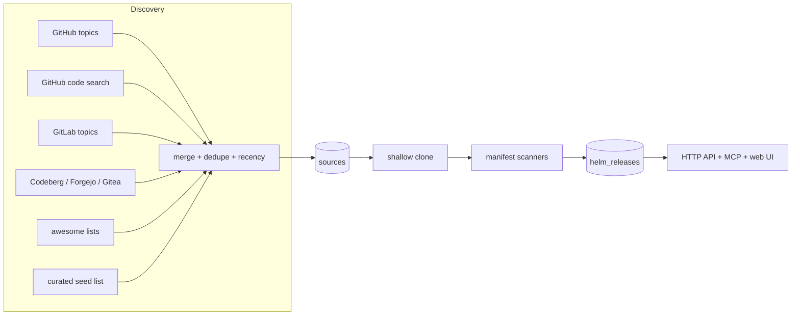

# helmscout

A self-hosted replacement for [kubesearch.dev](https://kubesearch.dev) that indexes
**more repositories, from more forges, with more manifest scanners** — and exposes
the index through an HTTP API and a [Model Context Protocol](https://modelcontextprotocol.io)
(MCP) server so agents can research how real homelabs configure their Helm charts.

It is written in **Elixir** on a **SQLite** database, so it runs comfortably on a
free/cheap VM or container host.

> kubesearch.dev is the frontend of [`whazor/k8s-at-home-search`](https://github.com/whazor/k8s-at-home-search),
> which crawls repos tagged `k8s-at-home` / `kubesearch` and parses four manifest
> kinds. This project widens every axis of that pipeline (see
> [differences from kubesearch.dev](#differences-from-kubesearchdev)).

## How it works



1. **Discover** (`Helmscout.Discovery`) — finds candidate repos from GitHub topics
   (GraphQL) and code search, GitLab, Gitea-compatible forges (Codeberg/Forgejo),
   curated awesome lists, your own users/orgs from `config/sources.yaml`, an
   optional sharded `helm_repos` code search, and a hand-maintained seed list.
   Duplicates are merged (union of topics/discoverers, max stars, newest push)
   and stale repos are dropped unless explicitly curated.
2. **Fetch** (`Helmscout.Fetch`) — shallow-clones each repo
   (`--shallow-since=1 year`, blob-size limited) and hard-resets on later runs.
   Unchanged repos are skipped via a `pushed_at`/`git ls-remote` check.
3. **Index** (`Helmscout.Indexer` + `Helmscout.Scanner`) — walks YAML, parses
   each document and extracts Helm releases with the scanners in
   `lib/helmscout/scanners/`.
4. **Serve** (`HelmscoutWeb`) — the Vue SPA, a server-rendered home page, a JSON API
   and an MCP server, all backed by the same SQLite database.

### Manifest scanners

| Scanner | Recognises |
| --- | --- |
| `flux_helm_release` | Flux `HelmRelease` with `spec.chart.spec` **or** `spec.chartRef` (HelmRepository, GitRepository, OCIRepository, HelmChart) |
| `argo_application` | Argo CD `Application` with a single source or multi-source (`spec.sources[]`) |
| `argo_application_set` | Argo CD `ApplicationSet` whose template deploys a chart |

Adding a scanner is a small, self-contained module implementing the
`Helmscout.Scanner` behaviour (`name/0`, `pre_check?/1`, `parse/1`) and
registering it in `Helmscout.Scanner.all/0`.

## Quickstart

Requires Elixir ~> 1.20 / OTP 27+ and `git`.

```sh
mix setup                     # deps.get + create + migrate

# 1. discover repositories (uses your gh CLI token if GITHUB_TOKEN is unset)
mix helmscout.discover

# 2. fetch + index them (start small)
mix helmscout.index --limit 20

# 3. serve the UI, API and MCP endpoint
mix phx.server                # http://localhost:4000
```

Or run the whole pipeline in one shot:

```sh
mix helmscout.update --limit 50
```

### Watching a run

Every stage logs progress as it happens, so a run is observable live:

```sh
# stage-by-stage, streaming
mix helmscout.discover
mix helmscout.fetch --limit 50
mix helmscout.index --limit 50 --concurrency 8

# or tee a full run to a log
mix helmscout.update 2>&1 | tee /tmp/opencode/logs/helmscout.log
```

While the server is up:

```sh
curl -s localhost:4000/api/stats | jq
curl -s 'localhost:4000/api/charts?q=immich' | jq
```

## mix tasks

| Task | Purpose |
| --- | --- |
| `mix helmscout.discover` | Find sources (`--dry-run`, `--max-age`, `--topics`, `--sources`, `--max-pages`, `--concurrency`) |
| `mix helmscout.fetch` | Clone/update working trees without indexing (`--limit`, `--concurrency`) |
| `mix helmscout.index` | Fetch + index existing sources (`--limit`, `--only-stale`, `--concurrency`, `--force`) |
| `mix helmscout.update` | Full pipeline (`--limit`, `--max-age`, `--index-only`, `--concurrency`, `--discovery-concurrency`, `--max-pages`, `--force`) |

## Guaranteeing your own repos are indexed

Topic search and code search will miss repos that carry no topics (including most
personal repos). Two ways in:

- Tag the repository with the **`helmscout`** (or `kubesearch` / `k8s-at-home`)
  GitHub topic — topic discovery picks it up automatically.
- List it explicitly in `config/sources.yaml` (override the path
  with `HELMSCOUT_SOURCES_CONFIG`):

```yaml
users:
  github:
    - hiemanshu
  gitlab:
    - some-user
  codeberg:
    - someone
  "gitea:https://git.example.com":
    - someone
```

Every public, non-fork, non-archived repo of these users/orgs is discovered
regardless of topics, then filtered by the usual recency window. The source is on
by default (`--sources users` to run it alone).

## Opting out

A repository owner can keep a repo (or an org) out of the MCP server by adding the
**`helmscout-hide-mcp`** GitHub topic, or a **`.helmscout-hide-mcp`** marker file in
the repo root. It still appears on the website and the JSON API; it is simply
omitted from MCP tool results.

To leave helmscout entirely, make the repository **private** — only public
repositories are indexed.

The same thing is shown to users on the `/about` page.

## Exhaustive manifest search (`helm_repos`)

For a thorough backfill beyond topics, the `helm_repos` source runs **sharded
GitHub code search**: it partitions the search space with `created:` date windows
and recursively splits any window that saturates the API's 1000-result cap, so it
can enumerate far more than a single query. Because code search allows only
~10 requests/minute it is **opt-in and slow**:

```sh
mix helmscout.discover --sources helm_repos --max-pages 20
```

## Incremental re-indexing

The indexer manages updates itself: before touching a repo it checks whether the
default branch moved (a cheap `pushed_at` comparison, then a `git ls-remote` SHA
check — no clone). Unchanged repos are reported as `skipped` and cost ~0ms, so
routine refreshes are fast:

```sh
mix helmscout.index --only-stale 1     # only sources not indexed in the last day
mix helmscout.index --force            # ignore the skip check, re-index everything
```

```
indexing [############--------] 42/120 35% | ok 12 empty 3 skip 26 err 1 | 1200 releases | 6.1/s ETA 0m12s
```

## Progress & parallelism

Long stages print a **plain progress line every 50 items** (so `mix` output and
CI/action logs both show progress) and write a timestamped, per-item log file
(the tail-able source of truth). The log path is printed when a run starts.

```
indexing: 4700 items -> log: log/indexing-20261015-063411.log
indexing: 50/4700 (45 ok, 5 empty, 0 skipped, 0 error, 135 releases, 8.2s)
indexing: 100/4700 (90 ok, 10 empty, 0 skipped, 0 error, 270 releases, 16.1s)
indexing done: 4700/4700 (4100 ok, 580 empty, 12 skipped, 8 error, 36000 releases, 642.3s)
```

```
tail -f log/indexing-*.log
# [06:34:45] ok    onedr0p/home-ops -> 68 releases (1835ms)
```

`HELMSCOUT_PROGRESS_STEP` sets the interval (default `50`).

Everything runs concurrently, bounded by the backend's rate limits:

| Stage | Parallelism | Notes |
| --- | --- | --- |
| Discovery sources | all sources at once | independent forges |
| HTTP transport | Finch pool, 25 conns + HTTP/2 | multiplexes many requests per host |
| GitHub topics | `--concurrency` (default 8) | **GraphQL** (cursor, newest-first) — the REST search API's ~30 req/min makes broad crawls slow and lossy |
| GitHub code search | 2 | REST only; ~10 req/min, backs off on 403/429 |
| GitLab / Gitea | `--concurrency` (default 8) | per (forge, topic) pair, concurrent |
| Clone + index | `--concurrency` (default = CPU count) | `Task.async_stream` |
| File scanning | 2× CPU count | per repository |

## Configuration

| Env var | Default | Purpose |
| --- | --- | --- |
| `GITHUB_TOKEN` / `GH_TOKEN` | `gh auth token` | GitHub API auth (discovery) |
| `HELMSCOUT_SEED_REPOS` | – | Extra `owner/repo` seeds (comma-separated) |
| `HELMSCOUT_TOPICS` | built-in list | Override GitHub/GitLab topics |
| `HELMSCOUT_GITEA_FORGES` | `https://codeberg.org` | Gitea-compatible forges |
| `HELMSCOUT_AWESOME_LISTS` | home-kubernetes fork + awesome-homelab | Raw README URLs to scrape |
| `HELMSCOUT_SOURCES_CONFIG` | `config/sources.yaml` | User/org repos to always include |
| `HELMSCOUT_PROGRESS_STEP` | `50` | Print a progress line every N items |
| `DATABASE_PATH` | `/data/helmscout.db` | SQLite file the app reads |
| `HELMSCOUT_DB_URL` | – | Where the app fetches the db at boot (release asset / bucket) |
| `HELMSCOUT_DB_TOKEN` | – | Bearer token for the db download, if the asset requires auth |
| `FRONTEND_DIR` | release `priv/static/frontend` | Built SPA served by the app |
| `FRONTEND_ORIGINS` | `*` | CORS allow-list for the API |
| `PORT`, `SECRET_KEY_BASE`, `POOL_SIZE` | 4000, –, 10 | Server (runtime/prod) |

Seeds can also be added without code changes in `priv/seed_repos.txt`.

## HTTP API

| Endpoint | Description |
| --- | --- |
| `GET /api/home` | Home payload: stats + top apps + the Discover pool |
| `GET /api/stats` | Source/release/chart/app counts, scanner + forge breakdown |
| `GET /api/popular?limit=` | Most widely deployed charts |
| `GET /api/charts?q=&limit=&offset=` | Chart names with aggregate counts |
| `GET /api/apps?q=&limit=&offset=` | Apps with aggregate counts |
| `GET /api/apps/:app` | One app: exact install/repo counts + its releases (newest 300) |
| `GET /api/apps/:app/recommendations` | Most common settings across installs of an app |
| `GET /api/releases?q=&chart=&source=&namespace=&scanner=&forge=&sort=&limit=&offset=&include_values=` | Individual releases (`q` matches app, chart or release name; `sort` is `popular`, `recent` or `name`) |
| `GET /api/releases/:id/values` | Full values object for one release |
| `GET /api/sources?q=&forge=&with_releases=&limit=&offset=` | Indexed source repos |
| `GET /api/random` | A random app or repository ("surprise me") |

## MCP server

The MCP endpoint is served at `POST /api/mcp` (Streamable HTTP, JSON-RPC 2.0) and
exposes these tools:

| Tool | Description |
| --- | --- |
| `search_helm_releases` | Filter releases by chart, source, namespace, scanner |
| `get_release_values` | Full values object for a release id |
| `popular_charts` | Most-deployed charts |
| `list_sources` | Indexed source repositories |
| `get_stats` | Index statistics |

### Register with OpenCode

```sh
opencode mcp add helmscout --url http://localhost:4000/api/mcp
```

or in `opencode.jsonc` (V2 uses `mcp.servers`; `oauth: false` for a local,
unauthenticated server):

```jsonc
{
  "$schema": "https://opencode.ai/config.json",
  "mcp": {
    "servers": {
      "helmscout": {
        "type": "remote",
        "url": "http://localhost:4000/api/mcp",
        "oauth": false
      }
    }
  }
}
```

### Register with any other MCP client

Point a Streamable-HTTP MCP client at `http://<host>:4000/api/mcp`. Verify by hand:

```sh
curl -s localhost:4000/api/mcp -H 'content-type: application/json' \
  -d '{"jsonrpc":"2.0","id":1,"method":"tools/list"}'
```

## Web UI

`web/` is a Vue 3 + Vuetify 3 single-page app (VueTorrent-style layout: left
sidebar, dark-first Tokyo Night theme, card grid, responsive, Fira Code). It talks
to the Phoenix **JSON API** — there is no client-side SQLite any more.

Features:

- Sidebar: search · repositories · statistics · mcp · about.
- Search with filters (manifest scanner, forge, source) and sort (most deployed /
  recently updated / alphabetical).
- **Most deployed apps** — generic `app-template` charts are resolved to the real
  app via container images, so `radarr`, `immich`, `plex`, … surface instead of
  `app-template`.
- **Discover** opens a random repo or app; the home strip surfaces apps only a few
  people run.
- App detail: every deployment across repos, plus a values drawer (JSON, copy).
- Repositories browser and a statistics dashboard.
- `/mcp` documents the MCP endpoint and gives copy-paste client setup.
- `/about` explains the project and the opt-out.
- Dark/light toggle, `Ctrl/⌘-K` focus search, `Esc` closes drawers.

### Dev

Two ways:

```sh
# a) production-like: Phoenix serves the built SPA
cd web && npm run build && cd ..
mix phx.server                       # http://localhost:4000

# b) HMR: Vite serves the SPA, /api + /mcp are proxied to Phoenix
mix phx.server                       # terminal 1 (:4000)
cd web && npm run dev                # terminal 2 (:5173)
```

`/config.json` (optional) sets the API base at runtime; when absent the SPA uses
same-origin. The deploy writes it with `{"apiBase": "https://api.helmscout.dev"}`.

The **home page** is server-rendered by Phoenix (`SpaController` injects the
"most deployed apps" + "discover" markup into the shell from the database), so it
paints instantly and is crawlable; Vue replaces it on hydration. There is no
build-time prerender step for the app itself — the deploy workflow only prerenders
`web/dist/index.html` for the static Pages copy.

`/sitemap.xml` and `/robots.txt` are served by Phoenix.

## Deployment

Three pieces, each free or very cheap:

| piece | where | cost |
| --- | --- | --- |
| **API + MCP** | a small always-on container (Fly, Render, Cloud Run, a VM…) | free–~€2/mo |
| **frontend** | Cloudflare Pages (static) | free |
| **database** | a SQLite file, built and published by your runner | free (GitHub release asset) |
| **runner** | your self-hosted GitHub Actions runner (holds the repo cache) | your infra |

The runner is the only writer. It builds `data/helmscout.db`, gzips it, and
attaches it to a rolling `db` release. The API is **read-only**: at boot it
downloads that file into `DATABASE_PATH` (see `HELMSCOUT_DB_URL`), so it needs no
persistent storage of its own.

### API + MCP

`.github/workflows/api.yml` builds and pushes `ghcr.io/<owner>/helmscout:latest`.
Run it anywhere:

```sh
docker run -p 4000:4000 \
  -e SECRET_KEY_BASE=$(openssl rand -base64 48) \
  -e DATABASE_PATH=/data/helmscout.db \
  -e HELMSCOUT_DB_URL=https://github.com/<owner>/<repo>/releases/download/db/helmscout.db.gz \
  -e FRONTEND_ORIGINS=https://helmscout.dev \
  ghcr.io/<owner>/helmscout:latest
# serves: /api/*  and  /api/mcp  (Streamable HTTP)
```

On a platform with no shell (Fly/Render/Cloud Run) the same three env vars in the
service config are all it needs. `PORT` is honoured.

### Frontend (Cloudflare Pages)

`.github/workflows/deploy.yml` runs on your runner and:

1. updates the index (`mix helmscout.update --only-stale 1`) + `mix helmscout.apps`,
2. compacts (VACUUM) and publishes the database to the rolling `db` release,
3. builds the SPA (`npm ci && npm run build`),
4. writes `web/dist/config.json` (API base) and `_redirects` (sitemap redirect + SPA fallback), then prerenders the home page,
5. deploys `web/dist` to Cloudflare Pages.

Secrets: `CLOUDFLARE_API_TOKEN`, `CLOUDFLARE_ACCOUNT_ID`. Repository **variable**
`API_BASE_URL` (e.g. `https://api.helmscout.dev`) is baked into `config.json`; leave
it empty for a single-host deploy where the app serves the SPA too.

### Single host (simplest)

You can skip the split entirely: run the container (which also serves the SPA) and
point it at the same SQLite file. Everything is one process.

## Development

```sh
mix test          # 37 tests covering scanners, discovery, indexing, search, visibility, MCP
mix compile       # no warnings
```

Layout:

```
lib/helmscout/            pipeline: discovery, fetch, indexer, scanners, search
lib/helmscout_web/        endpoint, router, controllers, MCP, EEx templates
lib/mix/tasks/             helmscout.{discover,fetch,index,update}
priv/repo/migrations/      SQLite schema
```

## Differences from kubesearch.dev

| | kubesearch.dev | this project |
| --- | --- | --- |
| Discovery | 2 GitHub topics + partial GitLab | many topics, GitHub code search, GitLab, Codeberg/Forgejo/Gitea, awesome lists, curated seeds |
| Scanners | 4 (Flux HelmRelease/HelmRepo/OCIRepo, Argo Application) | Flux `HelmRelease` (incl. `chartRef`), Argo `Application` incl. multi-source, `ApplicationSet` |
| Storage | static SQLite shipped as release assets, sql.js in browser | SQLite behind a live API |
| Interface | web search | web UI **+ HTTP API + MCP server for agents** |
| Language | Python + React | Elixir (Phoenix) + SQLite |

## Roadmap

- SQLite FTS5 full-text search over values blobs.
- More scanners: Kustomize, Helmfile, plain `kind: HelmRelease` v2beta, rendered manifests.
- Resolve chart versions from `HelmRepository`/`OCIRepository` resources.
- Scheduled indexing (Oban or a cron machine) and a live indexing dashboard.
- Chart icons and a richer web UI (LiveView).
